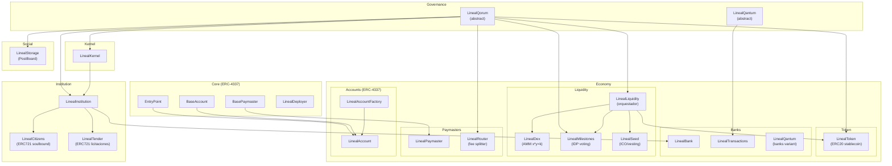
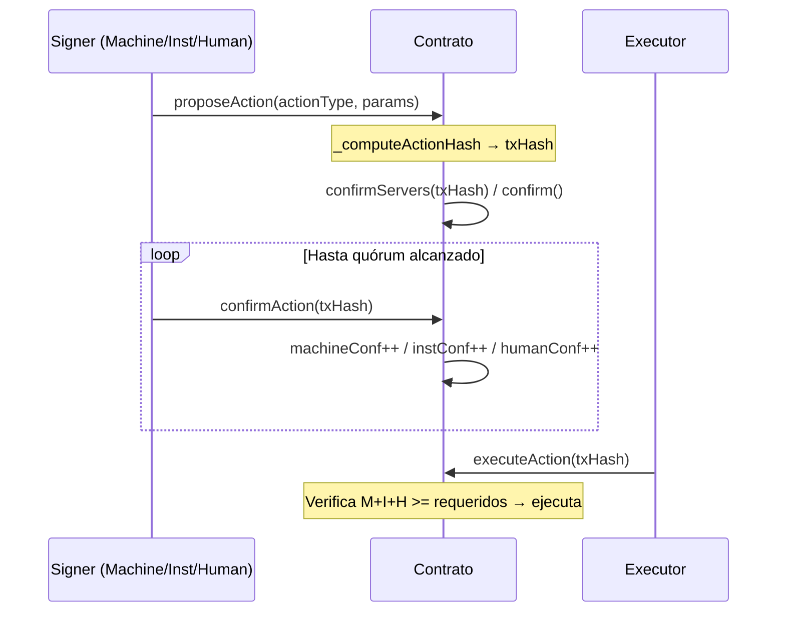
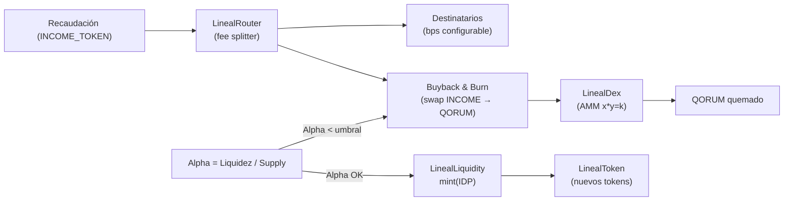

# Lineal Qorum Finternet — Protocolo de Contratos

> `pragma solidity ^0.8.30` · Autor: **NeoQuor — Lineal Qorum Fundation** · Licencia: UNLICENSED

---

**© 2024 NeoQuor — Lineal Qorum Fundation. Todos los derechos reservados.**

Esta obra se encuentra protegida por la Ley N° 17.336 sobre Propiedad Intelectual de la República de Chile y los tratados internacionales aplicables. Queda prohibida su reproducción, distribución, modificación o uso total o parcial sin autorización expresa y por escrito del titular de los derechos.

---

## Arquitectura General



---

## Mecanismo de Quórum (LinealQorum)

Todos los contratos administrativos heredan de `LinealQorum` (o su variante `LinealQantum`), que implementa un **multisig tripartito**:

| Capa | Tipo | Valor |
|------|------|-------|
| **1 — Machines** | Nodos/servers automatizados | `signerType = 1` |
| **2 — Institutions** | Contratos institucionales | `signerType = 2` |
| **3 — Humans** | Firmantes humanos (directiva) | `signerType = 3` |

### Flujo de una acción con quórum



### Recuperación con ZK (LinealQantum)

`LinealQantum` agrega un **sistema de recuperación con pruebas ZK (Groth16)**:
- Cada signer registra un `quantumCommitment` (hash de secreto).
- Para recuperar el quórum, presenta `ZKProof` con `nullifier`, `commitment`, `txHash`, `contractAddress`, `chainId`, `signerAddress`.
- Delay obligatorio de **2 horas** tras propuesta antes de ejecutar.

---

## Capas del Protocolo

### Governance

#### `LinealQorum.sol`
Contrato abstracto base. Define el sistema tripartito de quórum (Machines + Institutions + Humans), nonces de acciones, y el método `confirmServers` para validar firmas de la capa de servers.

#### `LinealQantum.sol` _(governance)_
Versión extendida del multisig tripartito con soporte nativo de **ZK-proofs** (Groth16). Usada por contratos que requieren mayor seguridad criptográfica en la recuperación de firmantes.

---

### Kernel

#### `LinealKernel.sol`
Registro central del ecosistema. Toda acción requiere quórum de servers.

| Función | Descripción |
|---------|-------------|
| `registerIssuer` | Registra emisores autorizados |
| `registerBank` | Registra bancos del protocolo |
| `registerInstitution` | Da de alta una institución |
| `registerCoin` | Registra tokens ERC20 válidos |
| `registerDns` | Registra DNS de apps (formato validado: minúsculas, dígitos, `.`, `-`, max 253 chars) |
| `isInstitutionRegistered` | View: valida si una institución está registrada |
| `isValidCoin` | View: valida si un token es moneda aceptada |

> [!NOTE]
> Usa **swap-and-pop** internamente para eficiencia O(1) en eliminación de listas de emisores/bancos/instituciones.

---

### Economy

#### `LinealToken.sol`
Stablecoin regulada 1:1 respaldada por FIAT (CLP). Hereda `ERC20`, `LinealQorum`, `Pausable`.

| Característica | Detalle |
|----------------|---------|
| **KYC en entrada** | Solo wallets `isWhitelisted` pueden recibir mint |
| **Circulación libre** | `transfer`/`transferFrom` sin restricción de whitelist |
| **Blacklist reactiva** | Bloquea envíos Y recepciones; administrada por quórum |
| **Mint/Burn** | Solo `linealLiquidityAddress` puede ejecutarlos |
| **Límite diario transfer** | 27,000,000 tokens |
| **Límite diario mint/burn** | 100,000,000 tokens |
| **Auditoría on-chain** | `mintHistory`, `burnHistory`, `recoveryHistory` |
| **Recuperación** | Solo desde cuentas en blacklist, con quórum y razón obligatoria |

---

#### `LinealBank.sol`
Custodia de tokens ERC20 por **subcuentas** (`bytes32 accountId`) para una institución.

| Función | Descripción |
|---------|-------------|
| `createSubAccount` | Crea subcuenta institucional (ID determinístico: `keccak256(name, addr, timestamp, length)`) |
| `createCitizenAccount` | Crea cuenta personal de ciudadano (solo el dueño puede moverla) |
| `deposit` | Acepta solo tokens en whitelist (`supportedToken`) |
| `release` | Retira fondos hacia el exterior |
| `internalTransfer` | Transferencia entre subcuentas del mismo banco; cobra `rewardsBps` a la subcuenta rewards |
| `bankTransfer` | Transferencia hacia banco externo vía `deposit` del destino |
| `setTokenSupport` | Habilita/deshabilita token para depósitos (saldos existentes nunca bloqueados) |

> [!IMPORTANT]
> `rewardsAccountId` se crea automáticamente en el constructor. Deshabilitar un token **no bloquea** retiros ni transferencias de saldos existentes.

---

#### `LinealTransactions.sol`
Contrato de transacciones institucionales con **doble multisig** (hereda `LinealQantum`):

```
Operador CREA tx → 3/3 autorizadores administrativos firman → Signers institucionales firman → EJECUCIÓN
```

| Campo de `QorumTransaction` | Descripción |
|-----------------------------|-------------|
| `to`, `amount`, `tokenAddress` | Destino y monto |
| `referenceHash` | Hash único de referencia (no reutilizable) |
| `expiresAt` | Expiración automática |
| `administrativeAuthorizers[3]` | 3 firmantes dinámicos definidos al crear |
| `meta` | `recipientName`, `motivo`, `documento`, `mensaje`, `tipo` |
| `staticMultiSigCompleted` | Flag de aprobación del quórum estático |

---

#### `LinealQantum.sol` _(banks)_
Variante simplificada de `LinealQantum` usada por contratos del módulo de banks. Multisig de lista plana de signers (sin tripartición) con soporte ZK-Groth16 y recuperación con delay de 2 horas.

---

#### `LinealLiquidity.sol`
Orquestador de liquidez del protocolo. Hereda `LinealQorum`, `Pausable`.

| Responsabilidad | Descripción |
|-----------------|-------------|
| **Rondas de capital** | Lanza seed y pre-seed (aprueba y deposita tokens en banco institucional) |
| **Índice Alpha** | Mide ratio liquidez / suministro circulante |
| **Buyback & Burn** | Cuando Alpha < umbral crítico: ejecuta swap en DEX y quema QORUM |
| **Emisión (mint)** | Libera nuevos tokens calculados por la política LCL/IDP |

Eventos clave: `UnlockExecuted(amount, alpha, idp)`, `BuybackAndBurn(incomeSpent, qorumsBurned)`.

---

#### `LinealDex.sol`
AMM de **producto constante** (`x * y = k`) para el par `INCOME_TOKEN / QORUM_TOKEN`.

| Parámetro | Valor |
|-----------|-------|
| Fee de swap | 30 bps (0.3%), queda en el pool |
| TWAP | Acumulador de precio estilo Uniswap V2 |
| LP Shares | Simplificadas (sin ERC20 de LP) |

Funciones: `swap`, `addLiquidity`, `removeLiquidity`, `spotPrice`, `getAmountsOut`.

---

#### `LinealSeed.sol`
ICO con pago en ERC20 (USDC/USDT) y vesting sobre `LinealToken`.

| Parámetro | Valor |
|-----------|-------|
| TGE inmediato | 20% (`IMMEDIATE_BPS = 2000`) |
| Cliff | 80% tras 180 días (`CLIFF_BPS = 8000`) |
| Fases | `softCap` (refund si no se alcanza) / `hardCap` (tope máximo) |

Flujo: `deposit tokens → buy → finalize → claim / refund`.

---

#### `LinealMilestones.sol`
Hitos del proyecto validados por votación de ciudadanos. Calcula el **IDP** (Índice de Desempeño).

| Parámetro | Valor |
|-----------|-------|
| Participación mínima | 20% del padrón congelado |
| Aprobación mínima | 66% de los votos emitidos |
| Duración votación | 3 – 30 días |
| Peso por hito | `uint8` (suma total ≤ 100) |

> [!NOTE]
> Un ciudadano = un voto. El padrón se congela al **abrir** el hito (snapshot de `tokenCounter` de `LinealCitizens`). El cierre es *permissionless* una vez vencido el plazo.

---

#### `LinealPaymaster.sol`
Paymaster ERC-4337. Un `verifyingSigner` off-chain aprueba pagar el gas de las `UserOperation`. Hereda `BasePaymaster`.

---

#### `LinealRouter.sol`
Splitter de ingresos configurable por quórum. Distribuye `INCOME_TOKEN` entre N destinatarios definidos en `recipients[]`, cada uno con `bps` y tipo de acción: `TRANSFER` o `BUYBACK_BURN`.

---

#### `LinealAccount.sol`
Smart account ERC-4337 (Simple Account). Hereda `BaseAccount`, `UUPSUpgradeable`, `Initializable`. Soporta `execute` y `executeBatch`.

#### `LinealAccountFactory.sol`
Factory para `LinealAccount` vía `CREATE2` + `ERC1967Proxy`. Retorna la dirección aunque ya esté desplegada.

---

### Institution

#### `LinealInstitution.sol`
Contrato central de cada institución/corporación. Hereda `LinealQorum`.

**En el constructor se despliegan automáticamente:**
- `LinealBank` (con `rewardsAccountId` y `institutionAccountId` pre-creados)
- `LinealTender` (NFT de licitaciones)

| Función | Descripción |
|---------|-------------|
| `setTokenSupport` | Habilita/deshabilita token en el banco (requiere quórum) |
| `setEconomicKernel` | Vincula el kernel para validar coins e instituciones |
| `createSubAccount` | Crea subcuenta en el banco institucional |
| `moveFundsToSubAccount` | Mueve fondos entre subcuentas propias |
| `moveFundsToBank` | Envía fondos a banco externo |
| `releaseFunds` | Libera fondos hacia dirección exterior |
| `issueProfile` / `issueTender` | Emite NFT de ciudadano / licitación |
| `processPayment` | Procesa un pago de ciudadano |

---

#### `LinealCitizens.sol`
NFT ERC721 de identidad/reputación por institución. **Soulbound** (no transferible por ciudadano).

```
Profile {
  tokenId       → ID del NFT
  username      → único dentro de la institución
  imageURI      → avatar
  subAccountId  → bytes32 de su cuenta en LinealBank
  reputation    → score 0–10,000
  exists        → flag
}
```

| Función | Descripción |
|---------|-------------|
| `issueProfile` | Mintea NFT para wallet (owner = institución) |
| `updateScore` | Ajusta reputación (delta 1–10,000); agrega/quita de `totalGlobalScore` |
| `updateProfileImage` | Actualiza `imageURI` |
| `getProfile(wallet)` | Devuelve `Profile` completo por dirección |

---

#### `LinealTender.sol`
Licitaciones como NFT ERC721. Custodiados por la institución (soulbound funcional). Cada NFT contiene:

```
Tender {
  tokenId, title, description, imageURI, documentURL,
  amount, createdAt, active, subAccountId
}
```

---

### Social

#### `LinealStorage.sol`
PostBoard on-chain (`PostBoard is LinealQorum`). Gestión de posts protegida por quórum tripartito para acciones sensibles (crear, editar, eliminar, moderar).

---

### Core (ERC-4337)

| Contrato | Descripción |
|----------|-------------|
| `EntryPoint.sol` | Punto de entrada ERC-4337 estándar |
| `BaseAccount.sol` | Base para smart accounts ERC-4337 |
| `BasePaymaster.sol` | Base para paymasters |
| `LinealDeployer.sol` | Deployer del protocolo |
| `GenesisVerifier.sol` | Verificador de génesis |
| `Groth16Verifier.sol` | Verificador ZK-SNARKs (Groth16) usado por `LinealQantum` |
| `NonceManager.sol` | Gestor de nonces para UserOps |
| `StakeManager.sol` | Gestor de stake para paymasters |

---

## Tabla Resumen de Contratos

| Contrato | Archivo | Hereda | Líneas |
|----------|---------|--------|--------|
| `LinealQorum` | `governance/LinealQorum.sol` | — | — |
| `LinealQantum` _(gov)_ | `governance/LinealQantum.sol` | `Groth16Verifier` | 372 |
| `LinealKernel` | `kernel/LinealKernel.sol` | `LinealQorum` | 529 |
| `LinealToken` | `economy/token/LinealToken.sol` | `ERC20, LinealQorum, Pausable` | 478 |
| `LinealBank` | `economy/banks/LinealBank.sol` | `Ownable, ReentrancyGuard` | 546 |
| `LinealTransactions` | `economy/banks/LinealTransaction.sol` | `LinealQantum` _(banks)_ | 472 |
| `LinealQantum` _(banks)_ | `economy/banks/LinealQantum.sol` | `Groth16Verifier` | 304 |
| `LinealLiquidity` | `economy/Liquidity/LinealLiquidity.sol` | `LinealQorum, Pausable` | 366 |
| `LinealDex` | `economy/Liquidity/LinealDex.sol` | `ReentrancyGuard` | 223 |
| `LinealSeed` | `economy/Liquidity/LinealSeed.sol` | `Ownable, ReentrancyGuard` | 296 |
| `LinealMilestones` | `economy/Liquidity/LinealMilestones.sol` | `LinealQorum` | 213 |
| `LinealPaymaster` | `economy/paymasters/LinealPaymaster.sol` | `BasePaymaster` | 96 |
| `LinealRouter` | `economy/paymasters/LinealRouter.sol` | `LinealQorum, Pausable` | 158 |
| `LinealAccount` | `economy/accounts/LinealAccount.sol` | `BaseAccount, UUPSUpgradeable` | 150 |
| `LinealAccountFactory` | `economy/accounts/LinealAccountFactory.sol` | — | 52 |
| `LinealInstitution` | `institution/LinealInstitution.sol` | `LinealQorum` | 522 |
| `LinealCitizens` | `institution/LinealCitizens.sol` | `ERC721, Ownable` | 407 |
| `LinealTender` | `institution/LinealTender.sol` | `ERC721, Ownable` | 288 |
| `LinealStorage` | `social/LinealStorage.sol` | `LinealQorum` | 439 |

---

## Política LCL — Ley de Conservación de Liquidez



**Alpha**: índice de salud de liquidez. Si cae bajo el umbral crítico, `LinealLiquidity` dispara Buyback & Burn automático.

**IDP** (Índice de Desempeño): suma de pesos de hitos aprobados en `LinealMilestones` (0–100). Controla cuánto puede mintearse.

---

## Eventos Clave por Módulo

### Economy
| Contrato | Evento |
|----------|--------|
| `LinealToken` | `Transfer`, `Mint`, `Burn`, `Blacklisted`, `Whitelisted` |
| `LinealBank` | `TokenDeposited`, `TokenReleased`, `InternalTransfer`, `BankTransfer`, `RewardsFeeCharged` |
| `LinealLiquidity` | `UnlockExecuted(amount, alpha, idp)`, `BuybackAndBurn(incomeSpent, qorumsBurned)` |
| `LinealMilestones` | `MilestoneCreated`, `Voted`, `MilestoneClosed` |

### Institution
| Contrato | Evento |
|----------|--------|
| `LinealInstitution` | `ProfileIssued`, `CitizenAccountCreated`, `TenderIssued`, `PaymentProcessed`, `SubAccountCreated` |
| `LinealCitizens` | `ProfileIssued(wallet, tokenId, username, subAccountId)`, `ScoreUpdated`, `ProfileImageUpdated` |
| `LinealTender` | `TenderMinted`, `TenderUpdated`, `TenderStatusChanged` |

### Governance
| Contrato | Evento |
|----------|--------|
| `LinealQorum` | `ActionProposed`, `ActionConfirmed`, `ActionExecuted` |
| `LinealQantum` | `QuantumCommitmentUpdated`, `RecoveryProposed`, `RecoveryConfirmed`, `RecoveryExecuted` |

---

## Errores Personalizados

```solidity
// LinealBank
error InvalidSubAccount();
error Bank_Unauthorized();
error Bank_InsufficientBalance();
error Bank_TokenNotSupported();
error Bank_PersonalAccount();      // intento de mover cuenta personal sin ser el dueño

// LinealInstitution
error BankNotLinked();
error TendersNotLinked();
error InvalidKernel();
error InstitutionNotEnabled();
error CoinNotValid(address token);

// LinealTender
error InvalidAddress();
error EmptyTitle();
error TitleTooLong();              // MAX_TITLE_LENGTH = 100 bytes
```
